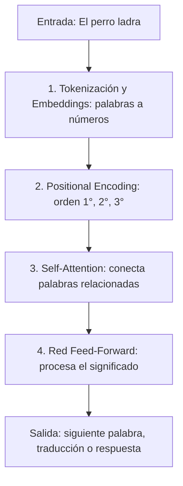

# 🤖 Redes Transformer (Explicado fácil)

Una **Red Transformer** es un tipo de inteligencia artificial que aprende a entender y generar texto (también imágenes, audio o código) mirando **todas las piezas al mismo tiempo** y descubriendo cuáles se relacionan entre sí.

> 💡 **Dato clave para clase:** Nació en 2017 con el famoso artículo de Google *"Attention Is All You Need"* y es el cerebro detrás de **ChatGPT, Gemini, Claude** y los traductores modernos (la **"T"** de GP**T** significa *Transformer*).

---

## 1. ¿Por qué fueron una revolución? (La linterna vs. encender la luz)

Imagina que estás leyendo un cuento largo:

* **Redes antiguas (RNN / LSTM):** Eran como leer en la oscuridad con una **linterna pequeña**, palabra por palabra, en fila. Si la frase era muy larga, al llegar al final ya habían olvidado el principio.
* **Red Transformer:** Es como **prender la luz de todo el cuarto**. Ve todas las palabras a la vez y las conecta al instante.

| Característica | Redes antiguas (RNN) | Redes Transformer |
| :--- | :--- | :--- |
| **Forma de leer** | Palabra por palabra (en fila) | Todas las palabras a la vez (en paralelo) |
| **Memoria en textos largos** | Se le olvida el inicio | Recuerda todo y conecta lo lejano |
| **Velocidad de entrenamiento** | Lenta (tiene que esperar turnos) | Muy rápida (aprovecha tarjetas gráficas / GPUs) |
| **Ejemplo cotidiano** | Mirar por un tubito | Ver la página completa de un vistazo |

---

## 2. Su superpoder: El mecanismo de Atención (*Self-Attention*)

Cuando lees una frase, tu cerebro sabe qué palabras van juntas. Mira este ejemplo:

> *"El **perro** no cruzó la calle porque **estaba** muy cansado."*

Si te preguntan **"¿quién estaba cansado?"**, tú sabes de inmediato que es **el perro**, no la calle. Un Transformer hace exactamente eso usando **Atención**: dibuja "hilos invisibles" más gruesos hacia las palabras más importantes para entender cada palabra.

```text
  "El   perro   no   cruzó   la   calle   porque   estaba   muy   cansado"
          ▲                         ▲                 │
          │                         │                 │
          └─────── (90% conexión) ──┴── (5% conexión) ┘
```

Además, usa **Multi-Head Attention** (atención multi-cabeza): en lugar de poner atención a una sola cosa, tiene varios "ojos" a la vez. Un ojo busca **quién hace la acción**, otro busca **qué pasó**, otro busca **el tiempo** (pasado o futuro), etc.

### ¿Cómo calcula esa atención? (La analogía de YouTube 🔍)

En clase verás tres letras famosas: **Q, K y V**. Aunque suenan técnicas, funcionan igual que buscar un video en YouTube:

| Letra | Nombre real | Analogía (YouTube / Biblioteca) |
| :--- | :--- | :--- |
| **Q** | *Query* (Consulta) | **Lo que tú escribes en el buscador:** *"receta de pastel"* |
| **K** | *Key* (Clave / Etiqueta) | **El título de cada video** que existe en la plataforma |
| **V** | *Value* (Valor / Contenido) | **El video completo** que miras cuando tu búsqueda (Q) coincide con el título (K) |

El Transformer compara cada palabra (**Q**) contra todas las demás (**K**) para decidir cuánta información (**V**) debe tomar de cada una.

---

## 3. ¿Cómo funciona paso a paso?



### Diccionario rápido (para entenderlo sin enredos)

| Pieza del Transformer | ¿Qué es en palabras simples? | ¿Por qué es necesaria? |
| :--- | :--- | :--- |
| **Tokenización** | Cortar el texto en piezas (palabras o sílabas) | La computadora no entiende letras, solo piezas numeradas |
| **Embeddings** | Convertir cada palabra en coordenadas de un mapa | Así sabe que *"perro"* y *"gato"* se parecen más que *"perro"* y *"avión"* |
| **Positional Encoding** | Darle un número de turno a cada palabra | Como lee todo a la vez, necesita saber que *"perro muerde hombre"* ≠ *"hombre muerde perro"* |
| **Self-Attention** | Subrayar con color fuerte las palabras relacionadas | Resuelve el contexto (ej. si *"banco"* es de sentarse o de dinero) |
| **Feed-Forward** | Una pequeña red neuronal clásica después de la atención | Digiere la información reunida y prepara la respuesta |

---

## 4. Las dos mitades: Encoder y Decoder

Un Transformer completo tiene dos partes (como un equipo de dos personas):

1. **Encoder (El Lector / Comprensor):** Lee toda la entrada, entiende el contexto y crea un "mapa de ideas".
2. **Decoder (El Escritor / Generador):** Toma ese mapa y va escribiendo la respuesta **una palabra a la vez**, cuidando que tenga sentido con lo que ya escribió.

Dependiendo de la tarea, hoy se usa solo una mitad o las dos:

| Arquitectura | ¿Qué partes usa? | ¿Para qué sirve? | Ejemplos famosos |
| :--- | :--- | :--- | :--- |
| **Solo Encoder** | Lee y entiende todo | Clasificar texto, detectar spam, buscar respuestas | **BERT** |
| **Solo Decoder** | Predice la siguiente palabra | Conversar, escribir código, resumir, crear historias | **GPT, Gemini, Claude, LLaMA** |
| **Encoder + Decoder** | Lee todo y lo transforma en otra cosa | Traducir idiomas (Español → Inglés) | **Transformer original (2017), T5** |

---

## 5. Resumen en 10 segundos (para la clase) 🎯

Si te preguntan **"¿Qué es una Red Transformer?"**, puedes responder esto:

1. **Es una arquitectura de IA (2017)** pensada originalmente para lenguaje, pero hoy usada en texto, imagen, audio y video.
2. **Procesa todo en paralelo**, no palabra por palabra, por eso es tan rápida y maneja textos enormes.
3. **Su truco principal es el *Self-Attention***: relaciona cada palabra con todas las demás para entender el contexto real (usando **Q, K y V**).
4. **Es la base de la IA moderna** como ChatGPT, los traductores actuales y los modelos generativos.
